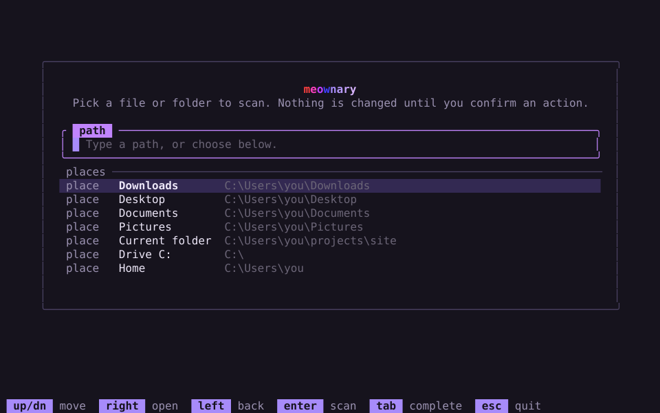

<h1 align="center">meownary</h1>

<p align="center">
  Deattributes software and scrubs files to prepare them for reverse engineering. Writes clean copies without the brand labels and patch credits that name who made them, and strips the metadata you pick.
</p>

<p align="center">
  <a href="#what-it-does">What it does</a> ·
  <a href="#deattribute">Deattribute</a> ·
  <a href="#scrub">Scrub</a> ·
  <a href="#undo">Undo</a> ·
  <a href="#interactive-view">Interactive view</a> ·
  <a href="#json-output">JSON output</a> ·
  <a href="#install">Install</a> ·
  <a href="#exit-codes">Exit codes</a>
</p>

<p align="center"></p>

## What it does

meownary scans a file or a folder, names each file's real format, and lists
what each file carries as findings. Two actions act on them:

- **Deattribute** is for software. It writes a copy of each file beside the
  original with brand labels, toolchain stamps and `patched by` credits blanked
  at the same length. The original is never touched.
- **Scrub** is for files. It removes the metadata you select, such as EXIF,
  document properties, build paths or archive comments, from the file itself.
  Every scrub can be undone.

Each finding has a category, a confidence, a severity and a signature id, and
may carry a removable marker: a byte range plus the method that removes it.
meownary makes no network requests.

## Deattribute or scrub

Deattribute is a fixed, quiet pass that writes clean copies; scrub edits the
findings you select in place.

| | Deattribute | Scrub |
|---|---|---|
| For | software: who made it and with what | files: the metadata they carry |
| Command | `clean <path> --deattribute` | `clean <path> --category <slug>` or `--signature <id>` |
| Key in the view | `a`, or `A` for deep | `d` |
| Writes | a `.deattributed` copy beside the original | the original file |
| Removes | `brand` labels and `patch` credits | any finding with a removable marker |
| Occurrences | every match | the reported one |
| Method | same-length blank or replacement | blank, truncate or structural rewrite |
| File length | unchanged; a ZIP or tar.gz copy may differ | may shrink |
| Weak findings | included | skipped unless `--force`, or scrubbed alone in the view |
| Warn-level edits | never run | run with `--force`, or after the view's confirm |
| Output names | paths, kinds, generic reasons | paths, signature ids, methods, reasons |
| Afterwards | the copy is rescanned to verify | `meownary undo` reverts it |

## Commands

The interactive view, `scan` and `clean` each take one path: a file, or a
folder they walk once, recursively.

```sh
meownary [<path>]
meownary scan <path> [--json] [--no-color] [--fail-on <severity>]
meownary clean <path> --deattribute [--deep] [--dry-run] [--json]
meownary clean <path> --category <slug> [--marker | --file] [--dry-run] [--force] [--json]
meownary clean <path> --signature <id> [--marker | --file] [--dry-run] [--force] [--json]
meownary undo [--last | --all] [--json]
```

- **Paths**: `scan` and `clean` need a path; `meownary` without one opens a
  file and folder picker. Hidden files are included, symbolic links are never
  followed, and meownary's state directory is never scanned.
- **Cloud-only files**: placeholders for files that are not stored locally are
  never opened, so nothing is downloaded. They are reported as partial with
  `cloud-only file, not downloaded`.
- **`scan`**: prints each file's findings with severity, confidence, title and
  signature id; a trailing `*` marks a removable marker. `--fail-on` takes
  `info`, `notice`, `warn` or `alert` and exits 1 once a finding reaches it.
- **`--dry-run`**: plans every edit and runs the safety checks, prints what
  would change, and writes nothing.
- **Flags**: go in any order, and a value follows its flag or joins it with
  `=`. `--` ends options, so later arguments are paths.
- **Environment**: `MEOWNARY_STATE_DIR` moves the state directory. `NO_COLOR`
  turns color off and `MEOWNARY_NO_ANIM` stills the view's wordmark, each when
  set and not empty. Progress bars keep moving either way while work runs.

## Deattribute

Deattribute writes a copy of each file with brand labels and `patched by`
credits blanked at the same length, and never prints what it removed.

```sh
meownary clean <path> --deattribute [--deep] [--dry-run] [--json]
```

In the view, `a` plans with the same rules. It blanks vendor and copyright
strings along with toolchain credits, so it is meant for software you build or
are entitled to change.

`--deep`, or `A` in the view, widens the sweep; see [Deep mode](#deep-mode).

### What it removes

Every blank is one of two kinds, `brand` or `patch`.

| Format | Value | Fill |
|---|---|---|
| PE | Rich header, from the masked `DanS` through the key after `Rich` | `0x00` |
| PE | CompanyName, ProductName, FileDescription, OriginalFilename, FileVersion and LegalCopyright strings | `0x00` |
| ELF | `.comment` strings that hold no file path | `0x00` |
| PE, ELF, Mach-O | `patched by` text, kind `patch` | `0x00` |
| Executables, MSI | `/rustc/`, `Mingw-w64 runtime failure`, `Inno Setup`, `InstallShield` | `0x00` |
| PDF | Info Producer and Creator values | `0x20`; `0` in hex strings |
| PDF | `Acrobat Distiller`, `Skia/PDF`, `Quartz PDFContext` outside Info | `0x20` |
| MP4 | encoder tag in `udta/meta/ilst` | `0x20` |
| Matroska, WebM | MuxingApp and WritingApp, unless Info has a CRC-32 | `0x20` |
| FLAC | Vorbis comment vendor string | `0x20` |
| WAV, AVI | `INFO/ISFT` software string | `0x20` |
| Audio, video | `Lavf`, `Lavc`, `x264 - core`, `x265 (build`, `HandBrake` | `0x00` |

- Catalog text credits are matched only in the first and last 64 KiB of a file,
  in the formats their catalog entry lists, weak matches included. Every match
  is blanked, though the scan lists a catalog entry once per file.
- `patched by` and the executable and media credits are blanked from the match
  to the end of its printable ASCII run, when that run ends within 80 bytes.
- Other version keys, the numeric file version and every key name stay.

### Deep mode

`--deep`, or `A` in the view, runs a wider sweep on top of the basic one. It
looks for copyrights, patch credits, build paths, licensing library marks, and
the vendor and product names the file itself gives away. Deep edits can break
loading, signing, registration and licensing behavior, and a plug-in whose
match name changes no longer matches projects saved with the original, so
inspect and test the copy before using it.

| Format | Deep also changes |
|---|---|
| PE | recognized identity bytes in data and code sections and the overlay past them, including RTTI, exports, URLs, registry keys and licensing strings; parsed import DLL/function names and thunk tables stay byte-exact; string table, dialog and message table resources; the .NET `#US` heap and assembly attribution; Adobe plug-in property lists named `PiPL` or `PIPL`, with neutral effect names and same-length match ids of at least three characters; the export directory's DLL name, rewritten to a neutral same-length `module` name; build and debug stamps, PDB paths, and the Authenticode directory, cleared so the copy is unsigned |
| ELF | strings in `.rodata`, `.data`, `.comment`, `.debug_str` and `.debug_line_str` |
| Mach-O | strings in `__TEXT` `__cstring`, `__const`, `__ustring` and `__oslogstring`, and `__DATA` `__const` and `__data`; the source and object file paths of debug stabs; the embedded code signature, blanked with `LC_CODE_SIGNATURE` emptied so the copy is cleanly unsigned |
| Resource fork | `STR ` and `STR#` strings and PiPL properties, in a raw Macintosh resource fork or an AppleDouble `._` file |
| Plain text | patch credits, copyright marks and build paths, filled with spaces up to the end of their line or quoted value, so quotes, tags and newlines stay put |
| Anything else | patch credits, copyright marks and build paths in NUL-terminated strings, only where the bytes around them do not look compressed or encrypted |

A name counts when the file states it outright, in a copyright line, a version
CompanyName, the export's module name, a .NET AssemblyCompany, a PiPL field or
a code signature's identifier, or when independent hints agree. In PE deep
mode, registry and install paths can establish a vendor, and a product found
in both a class and a display string can establish its name. Recognized names
are removed wherever their readable bytes occur in PE sections or the overlay past them, including
joined identifiers and UTF-16 strings, except inside parsed import names and thunk tables. This can
break code and host linkage.

Deep never touches:

- PE structural fields such as import and export address arrays, parsed import
  names and thunk tables, relocations, load config, and resource directory offsets;
- ELF `.dynstr`, `.symtab`, `.dynamic`, notes, unwind data or Go build info;
- Mach-O symbol names, `__LINKEDIT` data besides stab paths and the code
  signature, Objective-C class and selector names, or a section holding
  instructions;
- the names of resources in a resource fork, which the host looks up;
- URLs and registry keys outside PE files.

Outside PE deep mode and the structures above, a string is swept only when it stands alone:
between NUL bytes as UTF-8, Windows ANSI or UTF-16 text of up to 65,536
characters, or as a short string led by its own length byte. Text embedded in
a larger blob is left as it is.
Matches are whole words: `dispatched by` is not a `patched by` credit. A deep
sweep reads at most 256 MiB of a file. It reads only the file's bytes, never
its name, so the same file gives the same copy on disk, inside an archive and
on a rerun, and a deep copy plans nothing more.

### Archives

A ZIP, tar or tar.gz carries no attribution of its own, so deattribute cleans
the files inside it and writes `name.deattributed.zip`, `.tar` or `.tar.gz`
beside the original.

- Each file inside is identified and planned like a file on disk. Files with
  nothing to blank are copied byte for byte.
- Office documents, JAR and APK files are ZIP containers but are treated as
  single files, not as archives.
- Archives inside an archive are not opened; each is skipped as
  `nested archive`.
- A ZIP that is really a signed package (an APK or signed JAR the scan saw
  only as a ZIP, a wheel, a NuGet package) is skipped as `signed package`,
  since a copy would break the signature.
- Encrypted entries, entries over 256 MiB and unsupported compression methods
  are skipped with a reason; an archive over 1 GiB uncompressed is refused.
- When an archive stops being readable partway, everything after that point is
  skipped once as `rest of the archive is unreadable`.
- Each file inside keeps its length, but the archive's may change: a ZIP copy
  re-deflates the entries it changed, and a tar.gz copy is recompressed as one
  gzip member without the original's stored file name or comment.
- An archive with nothing to blank inside gets no copy and reports
  `nothing to blank inside the archive`.

### How it writes

- The copy is named after the original with `.deattributed` before the last
  extension, in the same folder, so it still opens and runs the same way.
- The original is read, never written. Each region is hashed when planned and
  checked again on the bytes copied, or the file is skipped.
- The copy is written to a temporary file, synced, then renamed into place. A
  copy from an earlier run is replaced, never stacked, and files that are
  already `.deattributed` copies are never deattributed again.
- Every edit keeps its length, so a file's copy keeps the original's size,
  layout and offsets. Basic mode writes raw blanks; deep mode can also write
  same-length replacements. Only blanks the safety check rates safe are
  planned, and none is forced.
- A PE copy's checksum is recomputed when the original had one, in both
  modes. A zero checksum stays zero.
- A file with nothing to blank gets no copy. Deattribute never opens the state
  directory, so there is nothing to undo: delete the copy to discard it.

### What it skips

A skip names one generic reason. A file's credits are skipped as
`load-bearing`, `no removable marker`, `unsafe edit`, `changed since scan` or
`io error`. Deep mode also reports names it found but had to keep, and what
it could not read: `identity in code`, `functional name kept`,
`functional value kept`, `malformed metadata` and `deep scan budget reached`.
Inside an archive, an entry can also be skipped as
`unsupported entry`, `entry too large`, `nested archive`, `signed package` or
`rest of the archive is unreadable`, and an archive with nothing to change
reports `nothing to blank inside the archive`.

<details>
<summary>What each reason covers</summary>

| Reason | When |
|---|---|
| `load-bearing` | the stamp is needed to load, unpack, install or play the file |
| `no removable marker` | the label has no safe blank, or a text credit runs past 80 bytes |
| `unsafe edit` | the blank is not rated safe, it overlaps a blank with another fill, planning failed internally, or the copy's path is a symbolic link or not a file |
| `changed since scan` | the original's size or bytes changed after planning |
| `io error` | the walk could not read the file (a cloud-only placeholder is never opened), the original could not be opened, or the copy could not be written |
| `identity in code` | a non-PE sweep found an identity in code it cannot edit |
| `functional name kept` | a name in a resource fork or other protected linkage could not be edited |
| `functional value kept` | a URL or registry key outside PE deep mode was kept |
| `malformed metadata` | a structure that can name the vendor (a PiPL list, .NET metadata, an embedded PDB, a code signature, a resource map) could not be read safely, so it is left as it is |
| `deep scan budget reached` | the deep sweep stopped at its 256 MiB read limit, or a record was too large to read |
| `unsupported entry` | an archive entry that is encrypted, ZIP64, corrupt or uses an unknown method |
| `entry too large` | an archive entry over 256 MiB uncompressed |
| `nested archive` | an archive inside the archive, which is never opened |
| `signed package` | a signed package whose signature the copy would break |
| `rest of the archive is unreadable` | the entries past a header that could not be read |

Load-bearing stamps: packer markers and PE packer section names, .NET metadata
and its runtime imports, Go build info and build ids, PyInstaller, Nuitka,
Electron, Qt and Delphi runtimes, installer stubs (NSIS, WiX Burn, 7-Zip and
WinRAR self-extractors, Squirrel), the LAME header in MP3, MP4 brand boxes, the
Office Open XML package, 7z, RAR and xz headers, and Mach-O build version and
encryption info.

</details>

### What it reports

- Each copy prints one line, `saved` with the copy's path, the original's name
  and its counts of `brand` and `patch` blanks, or `would save` in a dry run.
  A skip prints the path and its reason.
- A dry run checks the copy's path the way a real run does, so `would save`
  means the copy can be written there.
- A copy that loses something besides credits gets a caveat on stderr with the
  original's path: a signed file's copy reports
  `signature invalidated, re-sign to run`.
- The summary counts the copies saved beside their originals, how many of them
  are unverified, and the skips by reason. Offsets appear only in JSON.
- Nothing printed names matched text, titles, notes, evidence or signature ids.
- After writing, each copy is checked: it must be the original byte for byte
  apart from the planned spans, keep its format, and plan nothing more in the
  same mode. A PE deep copy is also checked against readable identities learned
  from its original, including code and overlay bytes. A name the sweep could not learn from the original is not checked. An archive copy must
  read as the same kind of archive and clean to nothing more. A copy that fails
  prints `verification incomplete for <copy>` and exits 75.
- Exit 75 means some file was not fully read, planned, written or verified. It
  wins over exit 1, which means something matched and no copy was written.

### What it never does

- Write to the original, delete a file, or change a file's length in its copy.
- Touch junk, tamper, integrity, identity, deception or bundleware findings,
  other than `patched by`, so other metadata stays in the copy.
- Accept `--force`, `--marker`, `--file`, `--category` or `--signature`; each
  is a usage error.
- Run a warn-level edit, or one the safety check refuses.
- Re-sign an executable. The copy of a signed file carries a broken
  signature, or none for a PE or Mach-O in deep mode, and the run reports the
  caveat.

## Scrub

Scrub removes the findings you select from the file itself, in any category,
each through the method its marker names.

```sh
meownary clean <path> --category <slug> [--dry-run] [--force] [--json]
meownary clean <path> --signature <id> [--dry-run] [--force] [--json]
```

In the view, `d` scrubs the highlighted finding, a file's findings, your picks
or a bucket, as [Interactive view](#interactive-view) lists.

### What it removes

- **`--category <slug>`**: every finding in one category: `identity`,
  `brand`, `integrity`, `tamper`, `deception`, `bundleware` or `junk`, in any
  letter case.
- **`--signature <id>`**: every finding with that exact signature id, as
  `scan` and the view print it.

Only findings with a removable marker change anything; the rest are skipped.

<details>
<summary>Which findings carry which method</summary>

- **Raw blank, `0x00`**: `pe.pdb_path`, `pe.rich_header`,
  `pe.version_info.junk`, `elf.comment.junk`, `elf.rpath`, `macho.rpath`,
  `jpeg.iptc`, `gif.app` (IPTC), `mp3.id3v2` (frames; the header stays),
  `cfb.summary` (UTF-16 text).
- **Raw blank, `0x20`** (`0` in PDF hex strings): `jpeg.comment`,
  `gif.comment`, `pdf.producer`, `pdf.creator`, `pdf.info`, `cfb.summary`
  (8-bit text), `zip.comment` (when data follows the end record),
  `gzip.fname`, `gzip.fcomment`, `rar.comment`, `flac.vendor`, `flac.tags`,
  `mkv.muxing_app`, `mkv.writing_app`, `mkv.title`, `mp4.encoder`,
  `mp4.metadata`, `riff.software`, `riff.info`,
  `catalog.producer.distiller`, `catalog.producer.skia`,
  `catalog.producer.quartz`.
- **Truncate**: `pe.overlay`, `pe.overlay_bloat`, `jpeg.trailing_data`,
  `png.trailing_data`, `zip.trailing_data`, `mp3.id3v1`.
- **Structural rewrite**: `jpeg.exif`, `jpeg.xmp`, `png.exif`, `png.text`,
  `png.time`, `webp.exif`, `webp.xmp`, `zip.comment` (when the end record ends
  the file), `tar.owner` (names cleared, length kept).
- **C2PA Content Credentials**: `jpeg.c2pa` (APP11 segments), `png.c2pa`
  (caBX and JUMBF chunks), `webp.c2pa`, and `mp4.c2pa` in MP4, HEIC and AVIF,
  where the box is zeroed and turned into free space so nothing moves.
- **HEIC and AVIF items**: `mp4.exif_item` and `mp4.xmp_item`; `mp4.xmp` turns
  its box into free space the same way.
- **Hidden text**: `text.invisible` (zero-width, tag and private-use
  characters), `text.spaces` (exotic spaces become plain spaces), `text.bidi`
  (bidi controls) and `text.ai_comment` (AI provenance comments in Markdown and
  HTML). Agent config files such as `CLAUDE.md`, `AGENTS.md`, `SKILL.md` and
  anything under `.git` are never touched.

Every other finding has no marker.

</details>

### How it edits

Each marker names one of three methods.

| Method | Effect on the bytes | Length |
|---|---|---|
| Raw blank | overwrites the region in place with one fill byte | unchanged |
| Truncate | cuts the file at the marker and drops the rest | shorter |
| Structural rewrite | rebuilds the container without the region and replaces the file atomically, up to 256 MiB | shorter, except tar owner names |

Every edit is rated before it runs:

| Rating | Runs | When |
|---|---|---|
| safe | yes | anything not listed below |
| warn | with `--force`, or after the view's confirm | truncating PE or Mach-O; dropping over 256 MiB; rewriting any container but a ZIP comment, PNG chunk, JPEG segment, RIFF chunk or tar header; deleting a file; a one-way marker |
| refuse | never | blanking offset 0 or the first 16 bytes of a structured format; an empty region or one past the end; truncating to 0 bytes or into the first 16 bytes; a symbolic link or anything but a regular file |

Edits that keep the length run first, then the others from the end of the file
backward, so earlier offsets stay valid. Before writing, the file size must
still match the scan.

### What it skips

A skip names its reason, with detail after a colon where one applies:
`no removable marker`, `weak confidence`, `needs --force`, `refused`,
`changed since scan`, `unsupported`, `io error` or `error`.

<details>
<summary>What each reason covers</summary>

| Reason | When |
|---|---|
| `no removable marker` | the finding has no marker |
| `weak confidence` | a weak finding without `--force` |
| `needs --force` | a warn-level edit without `--force` |
| `refused` | the safety check refuses the edit; `--force` does not change it |
| `changed since scan` | the file's size changed, or an earlier edit in the run removed the bytes |
| `unsupported` | no structural remover fits, it found nothing to change, or the file is over 256 MiB |
| `io error` | a read or write failed |
| `error` | any other failure |

</details>

### What it reports

- Each finding acted on prints one line: `would clean`, `cleaned` or
  `skipped`, the path, and the signature id in brackets. A dry run adds the
  method, length and offset; a skip adds its reason.
- A summary line counts skips by reason, and a run that changed files ends with
  a reminder that `meownary undo` reverts them.
- Exit 1 means findings matched and nothing was applied. Exit 75 means some
  files could not be fully read; when both apply, the run exits 1.

### What it never does

- Act on a finding outside the selection, or one without a marker.
- Run an edit the safety check refuses, even with `--force`.
- Remove a weak finding without `--force`, or as part of a bulk scrub in the
  view.
- Re-sign an executable or update its PE checksum. Scrubbing signed bytes
  invalidates the signature.

## Delete

Delete moves whole files to meownary's trash, and `meownary undo` moves them
back.

```sh
meownary clean <path> --category <slug> --file --force [--dry-run] [--json]
meownary clean <path> --signature <id> --file --force [--dry-run] [--json]
```

- Every file that carries a match moves once. Without `--force` it is skipped
  with `needs --force: removes the whole file`.
- In the view, `D` or `x` deletes the picked files, or the highlighted file,
  after a confirm.

## Undo

Scrub and delete save the original bytes before the file changes, so a run can
be put back.

```sh
meownary undo [--last | --all] [--json]
```

- **Groups**: one `clean` run, or one confirmed batch in the view, is one
  group. `undo`, `undo --last` and `u` revert the newest group; `--all`
  reverts every edit in the journal, newest first.
- **Order**: the original is saved and a journal record with fingerprints of
  the file before and after is synced to disk, then the file changes.
- **Storage**: blanks up to 4096 bytes keep the original bytes in the journal.
  Larger blanks, cut tails, whole-file snapshots of rewrites and deleted files
  go to the trash.
- **Changed files**: undo restores a file only while it matches what the edit
  left. Otherwise it stops and exits 1, and what it already reverted stays so.
- **Retention**: originals stay until undone, removed metadata included.
  Nothing expires.
- **One writer**: another meownary holding the state store makes scrub, delete
  and `undo` exit 73, and the view shows a notice instead of editing.

The state directory holds `trash/`, `undo-journal.jsonl` and `recent.json`, the
picker's last five picks, written only when you pick something in the picker.
`MEOWNARY_STATE_DIR` overrides the default:

| Platform | Default state directory |
|---|---|
| Linux | `$XDG_DATA_HOME/meownary`, else `~/.local/share/meownary` |
| macOS | `~/Library/Application Support/dev.bairon.meownary` |
| Windows | `%APPDATA%\bairon\meownary\data` |

## Interactive view

`meownary <path>` opens a terminal view over a streaming scan, one folder at
a time; `meownary` alone opens a picker first.

<p align="center"></p>

- **Picker**: browse with the arrows or `j` and `k`; `enter` or `right` opens
  a folder or scans a file, `left` or `backspace` goes up, and `s` scans the
  folder you are in. `/` filters the folder, or takes a typed path, and a
  pasted path jumps there. Recent picks come first, then common folders,
  drives and home. Folders show their file counts as they are counted, and
  the picker asks before scanning a whole home folder, the folder that holds
  every user's home, or a drive, with the count so far.
- **Reopen**: `o` brings the picker back over the view, at the folder you are
  in; `esc` returns to the view unchanged.
- **Folders**: the files pane shows one folder: its subfolders first, then its
  files. Rows stay put while the scan fills them in; a folder being scanned
  shows its own progress bar, then its file count and findings. `enter` or
  `right` opens a folder, `left` or `backspace` goes up, and the highlighted
  folder's summary fills the findings pane. `space` picks a folder, and `d`
  or `a` on a folder covers every file under it; delete works on files only.
- **Progress**: scans, plans, copies, scrubs, deletes and undo run in the
  background with a thin progress bar on the header, naming the file being
  worked on. The bar flows in the wordmark's rainbow, and a sheen in the same
  colors runs over the file in progress, or over the whole bar until there is
  something to count. `esc` stops after the current file; undo runs to the
  end.
- **Saved marks**: a file you scrub gets a `scrubbed` chip in the list. After
  deattribute, the original gets a `deattributed` chip and its copy a `copy`
  chip. The status line names what was saved.

| | `d` scrub | `a` deattribute, `A` deep | `D` or `x` delete |
|---|---|---|---|
| Picks made with `space` | picked findings, and the filtered findings of picked files | picked files, and the files of picked findings | picked files, else the highlighted file |
| Findings pane or detail | the highlighted finding | the highlighted file | the highlighted file |
| Files pane | the highlighted file's filtered findings | the highlighted file | the highlighted file |
| Buckets screen | every removable finding in the bucket | picks, else every file in the bucket | not available |

- **Confirm**: before anything is written, a prompt lists each edit with a
  `safe`, `warn` or `refuse` chip, the path, the signature id or kind, and the
  action with its size and offset. `y` goes ahead and `n` or `esc` cancels.
  Refused items never run.
- **Force**: for scrub and delete the confirm stands in for `--force`;
  deattribute never forces.
- **Deep**: `A` deattributes like `a`, in deep mode, the way `--deep` does.
- **Undo**: `u` reverts the newest scrub or delete group, a `clean` run
  included.
- **Editor**: `e` opens the highlighted file in `$VISUAL` or `$EDITOR`, else
  `notepad` on Windows and `vi` elsewhere. A change is journaled like a scrub.
- **Browse**: `enter` opens a finding's detail with the bytes around it, `b`
  groups findings, and `/` filters the folder you are in by path, format,
  signature id or title. `tab` switches panes, and `left` goes back from the
  findings to the files.

<details>
<summary>Key reference</summary>

<p align="center"></p>

</details>

## JSON output

With `--json`, `scan`, `clean` and `undo` print one JSON object per line,
ending with a `done` event that carries the exit code. `scan --json` prints
`identify`, `finding` and `done` events.

<details>
<summary><code>clean --deattribute</code> fields</summary>

| Field | Events | Value |
|---|---|---|
| `event` | all | `would_clean`, `cleaned`, `caveat`, `would_save`, `saved`, `skipped` or `done` |
| `path` | per file | the original, as walked |
| `output` | `would_clean`, `cleaned`, `would_save`, `saved` | the copy's path |
| `kind` | `would_clean`, `cleaned`, `skipped` | `brand` or `patch`; absent when a whole file or an archive entry is skipped |
| `op`, `offset`, `len` | `would_clean`, `cleaned` | `raw_blank`, or `replace` for a same-length replacement, and the region |
| `caveat` | `caveat` | what the copy loses besides credits: `signature invalidated, re-sign to run` |
| `edits` | `would_save`, `saved` | edits in the copy |
| `entries` | `would_save`, `saved` | for an archive, files inside that were cleaned |
| `verified` | `saved` | whether the written copy checked out; `false` makes the run exit 75 |
| `entry` | `skipped` | for an archive, the path inside it |
| `reason` | `skipped` | one of the reasons under [What it skips](#what-it-skips) |
| `cleaned`, `skipped`, `saved` | `done` | counts; a dry run counts what it would do |
| `dry_run` | `done` | whether nothing was written |
| `files`, `partial_files` | `done` | files walked, and files not fully read, planned, written or verified |
| `exit` | `done` | the exit code |
| `error` | `done` | why the run stopped before the walk, on a usage error |

No event carries `title`, `note`, `signature`, `evidence` or `label`.

</details>

<details>
<summary><code>clean --category</code> and <code>--signature</code> fields</summary>

| Field | Events | Value |
|---|---|---|
| `event` | all | `would_clean`, `cleaned`, `skipped` or `done` |
| `path` | per finding | the file, as walked |
| `label` | per finding | the journal label: the signature id, or `delete file` |
| `signature`, `category`, `severity` | per finding | from the finding |
| `op` | per finding | `raw_blank`, `truncate`, `structural_remove`, `delete_file`, or null |
| `offset`, `len` | per finding | bytes touched; null without a marker |
| `undo_id` | `cleaned` | the journal record id |
| `reason` | `skipped` | the reason, with any detail |
| `cleaned`, `skipped`, `dry_run` | `done` | counts, and whether nothing was written |
| `by_reason` | `done` | skip counts keyed by reason |
| `files`, `partial_files`, `exit` | `done` | files walked, files not fully read, the exit code |
| `error` | `done` | why the run stopped, when the state store failed |

</details>

<details>
<summary><code>undo</code> fields</summary>

| Field | Events | Value |
|---|---|---|
| `event` | all | `undone` or `done` |
| `count` | `undone` | edits reverted |
| `undone`, `exit` | `done` | edits reverted, the exit code |
| `error` | `done` | why undo failed, when it did |

</details>

## Install

Prebuilt archives for Linux, macOS and Windows are on the
[releases page](https://github.com/baairon/meownary/releases).

| Platform | Targets |
|---|---|
| Linux (static) | `x86_64-unknown-linux-musl`, `aarch64-unknown-linux-musl` |
| macOS | `aarch64-apple-darwin`, `x86_64-apple-darwin` |
| Windows | `x86_64-pc-windows-msvc` |

Archives are named `meownary-<version>-<target>.tar.gz`, or `.zip` on Windows.
Each has a `.sha256` file, and `SHA256SUMS` lists them all.

Building from source needs Rust 1.88 or newer:

```sh
git clone https://github.com/baairon/meownary
cd meownary
cargo build --release --locked
```

The binary lands at `target/release/meownary`.

## Exit codes

Every command exits with one of seven codes.

<details>
<summary>Codes 0, 1, 2, 73, 75, 101 and 130</summary>

| Code | Meaning |
|------|---------|
| 0    | success |
| 1    | `scan --fail-on` was met; `clean` matched but changed nothing; `undo` failed; the view failed |
| 2    | bad command, flag or value, a missing path, or a path that does not exist |
| 73   | the state store could not be opened, or another meownary holds it; nothing was edited |
| 75   | some files could not be fully read, or a deattributed copy could not be written or verified; for deattribute it wins over 1 |
| 101  | internal error; meownary prints where to report it |
| 130  | interrupted with Ctrl-C (Windows reports 0xC000013A instead) |

</details>

## License

MIT. Copyright (c) 2026 bairon.dev.
